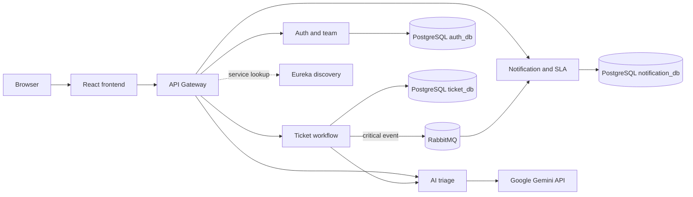

# ResolveAI

**AI-assisted customer support ticketing with role-aware workflows, automatic assignment, and human-verified replies.**

## The problem

Support teams spend time sorting incoming requests, finding the right agent, and writing first responses. ResolveAI triages ticket text, recommends an assignment, highlights critical issues, and prepares a draft reply while leaving final responses under agent control.

## How it works

1. A customer registers, signs in, and submits an issue.
2. The ticket service asks AI Triage to classify category, priority, sentiment, summary, and a draft reply.
3. It assigns the ticket to the least-loaded agent in the matching department and saves its SLA deadline.
4. Critical tickets publish a RabbitMQ event, with a REST fallback, for the notification service.
5. An agent reviews the Kanban card and AI Co-Pilot draft, then verifies and sends a reply.

## Features by role

- **Customer:** submit issues, track only their own tickets, and read verified replies. AI analysis, SLA deadline, and agent identity fields are redacted from customer ticket responses.
- **Agent:** view tickets, filter and search the Kanban board, review AI triage, start work, and verify replies.
- **Admin:** use the agent workspace and create team accounts with roles and departments.

## Architecture



| Service | Port | Database | Responsibility |
| --- | ---: | --- | --- |
| Frontend | 3000 | — | Customer portal and agent/admin workspace |
| API Gateway | 8080 | — | Browser entry point, routing, and CORS |
| Discovery Server | 8761 | — | Eureka service registry |
| Auth & Team (`auth-team-service`) | 8081 | `auth_db` | Accounts, JWTs, roles, agent workload |
| Ticket Workflow (`ticket-workflow-service`) | 8082 | `ticket_db` | Ticket lifecycle, comments, assignment, critical event publishing |
| AI Triage (`ai-triage-service`) | 8083 | — | Gemini integration, parsing, and fallback classification |
| Notification & SLA (`notification-sla-service`) | 8084 | `notification_db` | Critical alerts, acknowledgements, SLA breach alerts |
| PostgreSQL | 5432 internal | — | Persistent service data |
| RabbitMQ | 5672 internal; management UI 15672 | — | Critical ticket messages |

## Tech stack

Java 17, Spring Boot 3, Spring Cloud, Eureka, OpenFeign, Spring Security/JWT, PostgreSQL 16, RabbitMQ, Google Gemini REST API, React 18, Vite, Tailwind CSS, Docker Compose, and GitHub Actions.

## Project structure

```text
backend/       Six Spring Boot services
docs/          Product, architecture, API, UI, deployment, test, and prompt notes
docker/        Compose stack, PostgreSQL initialization, environment example
frontend/      React and Vite application
postman/       API collection and local environment
.github/       CI/CD workflow
```

## Quick start with Docker

Prerequisites: Docker Desktop with Compose, at least 8 GB RAM recommended (4 GB works with slower startup), and a Google Gemini API key if you want live AI triage. Without a key, ticket creation uses the documented fallback.

1. Copy `docker/.env.example` to `docker/.env`.
2. Set unique strong values for `POSTGRES_PASSWORD`, `RABBITMQ_PASS`, and `JWT_SECRET` (at least 32 characters). Set `BOOTSTRAP_ADMIN_EMAIL` and `BOOTSTRAP_ADMIN_PASSWORD`; the initial admin is created only if no admin exists yet. Optionally set `GEMINI_API_KEY`.
3. Start the stack:

   ```bash
   docker compose -f docker/docker-compose.yml up -d --build
   ```

   On low-memory machines, enable the `JAVA_OPTS` setting in `docker/.env` to reduce each Java service heap, then start in stages, waiting for each group to become healthy before continuing:

   ```bash
   docker compose -f docker/docker-compose.yml up -d postgres rabbitmq
   docker compose -f docker/docker-compose.yml up -d --build discovery-server
   docker compose -f docker/docker-compose.yml up -d --build auth-team-service ai-triage-service
   docker compose -f docker/docker-compose.yml up -d --build ticket-workflow-service notification-sla-service
   docker compose -f docker/docker-compose.yml up -d --build api-gateway
   docker compose -f docker/docker-compose.yml up -d --build frontend
   ```

| Local URL | Service |
| --- | --- |
| <http://localhost:3000> | Frontend |
| <http://localhost:8080> | API Gateway |
| <http://localhost:8080/actuator/health> | Gateway health |
| <http://localhost:8761> | Eureka dashboard |
| <http://localhost:15672> | RabbitMQ management UI (credentials from `RABBITMQ_USER` / `RABBITMQ_PASS`) |

The database and internal services are not published on all network interfaces; their mapped ports bind to localhost.

## Local development without Docker

Run frontend with `cd frontend && npm install && npm run dev`. Run each backend module with `mvn spring-boot:run` from its directory. Local service defaults expect PostgreSQL on `localhost:5432`, RabbitMQ on `localhost:5672` when enabled, Eureka on `localhost:8761`, and the frontend API at `http://localhost:8080`. Set the corresponding environment variables from `docker/.env.example` for a complete local stack.

## Environment variables

Copy `docker/.env.example`; it contains placeholder/example values only. Do not commit local credentials.

| Variable | Used by | Purpose |
| --- | --- | --- |
| `POSTGRES_USER`, `POSTGRES_PASSWORD` | PostgreSQL and database-backed services | Database credentials |
| `JWT_SECRET`, `JWT_EXPIRATION_MS` | Auth and JWT-validating services | Shared JWT signing key and lifetime |
| `BOOTSTRAP_ADMIN_NAME`, `BOOTSTRAP_ADMIN_EMAIL`, `BOOTSTRAP_ADMIN_PASSWORD` | Auth & Team | First administrator, when no admin exists |
| `GEMINI_API_KEY`, `GEMINI_MODEL` | AI Triage | Gemini access and model selection |
| `RABBITMQ_ENABLED`, `RABBITMQ_USER`, `RABBITMQ_PASS` | Ticket and Notification services; RabbitMQ | Critical event transport and credentials |
| `VITE_API_BASE_URL` | Frontend image build | Gateway URL embedded in frontend |
| `CORS_ALLOWED_ORIGINS` | API Gateway | Allowed frontend origin |
| `JAVA_OPTS` | Java containers | Optional JVM memory settings |

Compose supplies internal service URLs and database names. See `docker/.env.example` for the full set of supported settings.

## API documentation

API paths and request/response contracts are documented in [docs/05_API_CONTRACT.md](docs/05_API_CONTRACT.md). OpenAPI UI is configured on the four API services:

- <http://localhost:8081/swagger-ui.html> — Auth & Team
- <http://localhost:8082/swagger-ui.html> — Ticket Workflow
- <http://localhost:8083/swagger-ui.html> — AI Triage
- <http://localhost:8084/swagger-ui.html> — Notification & SLA

The Postman collection under `postman/` runs the gateway APIs from setup through health checks. See [postman/README.md](postman/README.md) for import and Newman instructions.

## Testing

Run `mvn -B test` from each backend service directory and `npm test` from `frontend/`. In this local session, all six backend modules passed **87 tests** and the frontend passed **124 tests** (211 total). The backend ran on local JDK 25.0.4 while compiling to Java 17; frontend used local Node 24.18.1. CI uses Java 17 and Node 20. Details and test mapping are in [docs/09_TESTING.md](docs/09_TESTING.md).

## CI/CD

GitHub Actions tests all six backend modules and the frontend, builds seven container images, publishes images on pushes to `main`, and can run a Compose smoke test on `main` pushes or manual dispatch. See section 6 in [docs/10_DEPLOYMENT.md](docs/10_DEPLOYMENT.md).

## Deployment overview

The documented deployment approach serves the frontend from Vercel and runs the backend Compose stack on AWS EC2. Review prerequisites, configuration, and deployment steps in [docs/10_DEPLOYMENT.md](docs/10_DEPLOYMENT.md). Deployment has not been verified for this release.

## Roles and access

| Capability | Customer | Agent | Admin |
| --- | --- | --- | --- |
| Public registration | Yes; customer role only | No | No |
| Create team accounts | No | No | Yes |
| Submit tickets | Yes | Yes | Yes |
| Ticket visibility | Own tickets | All tickets | All tickets |
| Change workflow / verify replies | No | Yes | Yes |
| Notification alerts | No | Yes | Yes |
| AI triage and draft fields in ticket responses | Redacted | Visible | Visible |

## Security notes and known limitations

- PostgreSQL schema uses `ddl-auto=update`; database migrations are not set up.
- JWTs are stored in browser `localStorage`.
- The critical-event REST fallback accepts any authenticated user; production should use an internal service credential.
- “Resolved Today” currently uses the UTC day.
- Agents and admins can see all tickets; assignment is informational.
- Gemini free-tier quota and model availability may affect live triage; fallback behavior remains available.
- A 4 GB Docker host may start slowly; 8 GB is recommended.

## AI-assisted workflow

The project used an architect-style prompt workflow with TrainingMug ADF, one module or feature scope per prompt, explicit assumptions, verification loops, human review, and manual commits. See [docs/11_PROMPTS.md](docs/11_PROMPTS.md) for the prompt log and reusable template.

## Screenshots

Add screenshots under `docs/screenshots/`:

- [ ] Login
- [ ] Customer portal
- [ ] Submit Issue
- [ ] Agent dashboard
- [ ] AI Co-Pilot drawer
- [ ] Notification bell
- [ ] Team page
- [ ] Eureka
- [ ] RabbitMQ queue

## License and author

License: not specified. Author: not specified.
